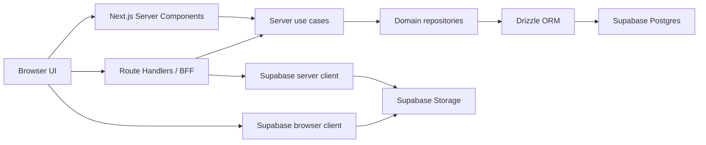

# Potokuadrat Architecture

## Direction

This project adopts the useful architectural ideas from `documents/web/lomba-mia`: a Next.js App Router application acting as a backend-for-frontend, feature-oriented UI code, explicit cross-layer contracts, and server-only use cases and repositories. The product domain, database schema, endpoints, and contracts remain specific to Potokuadrat and are intentionally undefined until its behavior is agreed.

## Request and data flow



## Ownership and dependency rules

| Area | Owns |
| --- | --- |
| `src/app/**` | Pages, layouts, and thin HTTP route adapters |
| `src/features/<domain>/**` | Domain-specific UI and browser interactions |
| `src/server/api/**` | HTTP input validation, authorization, and response mapping |
| `src/server/<domain>/**` | Use cases, repository interfaces, and persistence adapters |
| `src/server/db/**` | Drizzle connection, schema, and database access |
| `src/server/storage/**` | Server-side Storage operations |
| `src/contracts/**` | Types shared across browser and server boundaries |
| `src/lib/supabase/**` | Supabase client construction using public project credentials |
| `drizzle/**` | Generated database migrations |

Allowed flow:

```text
Browser UI -> shared contract -> Route Handler -> domain API/use case -> repository -> Drizzle -> Postgres
Browser upload or download -> Supabase Storage client -> bucket policy (RLS)
```

Client components must not import `src/server/**`, Drizzle, or database credentials. Route Handlers should delegate rather than contain business rules or SQL. Keep validation at the HTTP boundary; TypeScript types alone do not validate input. Mark server-only modules with `server-only`.

## Database and files

- Drizzle schema definitions are the source of truth for application-owned Postgres tables; commit generated SQL migrations and review them before deployment.
- Use `DATABASE_URL` for the app's pooled Postgres connection. Use `MIGRATION_DATABASE_URL` for Drizzle Kit when applying migrations, normally a direct connection.
- A Drizzle connection authenticated with a database owner credential can bypass Supabase Row Level Security. Treat the BFF as a trusted boundary: every data operation still needs application authorization. If a feature relies on database RLS, configure a restricted database role and pass the intended user context explicitly before relying on those policies.
- Supabase Storage is accessed through the Supabase SDK. Bucket access is governed by Storage policies and user-scoped sessions; never expose a service-role key to browser code.
- Store a Storage object path and relevant metadata in Postgres when a product feature requires a durable file reference. Keep the bytes in Storage.
- No domain tables, bucket policies, auth flow, or API endpoints are assumed in this bootstrap.

## Growth path

Add a feature only after defining its user behavior and data ownership. Keep its request/response contract independent of the database representation where practical. Add repository methods for domain operations, then choose the minimum schema and Storage policy needed for that feature. Background jobs or external ingestion should run as separate processes if their lifecycle, credentials, or retries differ from web requests.
