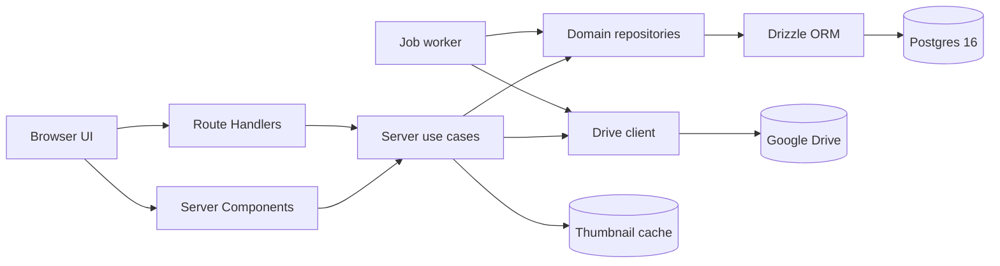

# Potokuadrat Architecture

## Direction

Potokuadrat is a self-hosted client gallery over Google Drive. A Next.js App Router
application acts as the backend-for-frontend: it reads Drive with a service account,
indexes photo metadata into Postgres, caches thumbnails on local disk, and serves
share pages and downloads to anonymous clients.

The product behavior is defined in `docs/specs/`; the decisions that changed the
original plan are in `docs/adr/`. This file only covers how the code is organized.

## Stack

- Next.js 16 (App Router, TypeScript) on Node 24
- Postgres 16 with Drizzle ORM (`pg` driver)
- `pg-boss` for jobs, running in the app process for v1
- Better Auth for organization users; signed cookies for client sessions
- Tailwind 4 plus the in-repo design system in `src/components/ui`
- Docker Compose: `app`, `postgres`, and a one-shot `migrate` service

## Request and data flow



The browser never receives a Drive URL. Thumbnails and downloads are served by this
application, which fetches from Drive and writes the stripped thumbnail to the cache.

## Ownership and dependency rules

| Area | Owns |
| --- | --- |
| `src/app/**` | Pages, layouts, and thin HTTP route adapters |
| `src/features/<domain>/**` | Domain UI and browser interactions |
| `src/server/api/**` | HTTP input validation, authorization, response mapping |
| `src/server/<domain>/**` | Use cases, repository interfaces, persistence adapters |
| `src/server/drive/**` | Drive auth, listing, thumbnail fetch, cache, segment stripping |
| `src/server/jobs/**` | pg-boss registration and job handlers |
| `src/server/db/**` | Drizzle connection, schema, migrations access |
| `src/contracts/**` | Types and schemas shared across the browser/server boundary |
| `src/components/ui/**` | Generic design-system primitives |
| `drizzle/**` | Generated database migrations |

How the backend and UI workstreams split this repository, run contracts first, and
review across the boundary is in `docs/WORKFLOW.md`. ESLint enforces the import
boundary: UI modules cannot import `src/server/**`, and contracts cannot import
server, UI, or framework code.

Allowed flow:

```text
Browser UI -> shared contract -> Route Handler -> use case -> repository -> Drizzle -> Postgres
Route Handler -> use case -> Drive client -> thumbnail cache -> response
```

Client components must not import `src/server/**`, Drizzle, or credentials. Route
Handlers delegate instead of holding business rules. Validate at the HTTP boundary;
TypeScript types do not validate input. Mark server-only modules with `server-only`.

## Domain rules that affect structure

- **Shares are the access unit, not albums.** Every thumbnail, download, and gallery
  page is authorized against the share, its expiry, its photo subset, and its allowed
  qualities.
- **Thumbnails are cache, not data.** They live on disk, are safe to delete, and are
  keyed by Drive file ID, width, and metadata mode. Postgres is the source of truth
  for metadata.
- **Originals are streamed.** Never persist them. Proxy from Drive on request.
- **Photo rows are not deleted on re-index.** Missing files become `missing` and are
  hidden from clients; favorites and history survive.
- **Favorites have one owner per mode.** Magic-link sessions persist them in Postgres,
  keyed by the client session, and a returning email reuses its live session so the list
  survives a new link. Public and password shares keep favorites in the browser.
- **Branding is data.** Organization and share rows own title, logo, and accent; no
  static file is read at request time.

## Auth and sessions

- Organization users sign in with Better Auth (email + password). Sessions are
  HttpOnly, Secure, SameSite=Lax cookies.
- Clients never get an account. Public shares need no session; password shares get a
  signed cookie after the password check; magic-link shares exchange a one-time token
  for a client session row.
- `/setup` is only available while no user exists, then redirects to `/login`.
- Rate-limit login, share passwords, and magic-link exchange.

## Files and storage

- Postgres stores organizations, users, albums, photos, shares, sessions, favorites,
  and analytics events. Generated SQL migrations are committed.
- `THUMB_CACHE_DIR` holds `<drive-file-id>-<width>-<mode>.jpg`. The cache has a size
  and file cap with LRU eviction and no backup.
- `DATABASE_URL` points at the Compose Postgres directly. No transaction pooler; if one
  is introduced later, migrations and `pg-boss` need their own direct connection.

## Growth path

Add a feature only after its behavior and data ownership are defined in a spec. Keep
request/response contracts independent of the schema where practical, add repository
methods for domain operations, then the minimum schema and policy needed. Background
work goes through `pg-boss`; split a separate worker process only when lifecycle,
credentials, or retries diverge from web requests.
