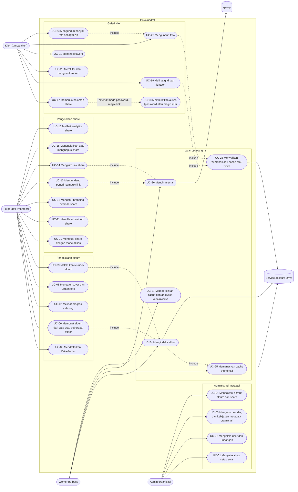
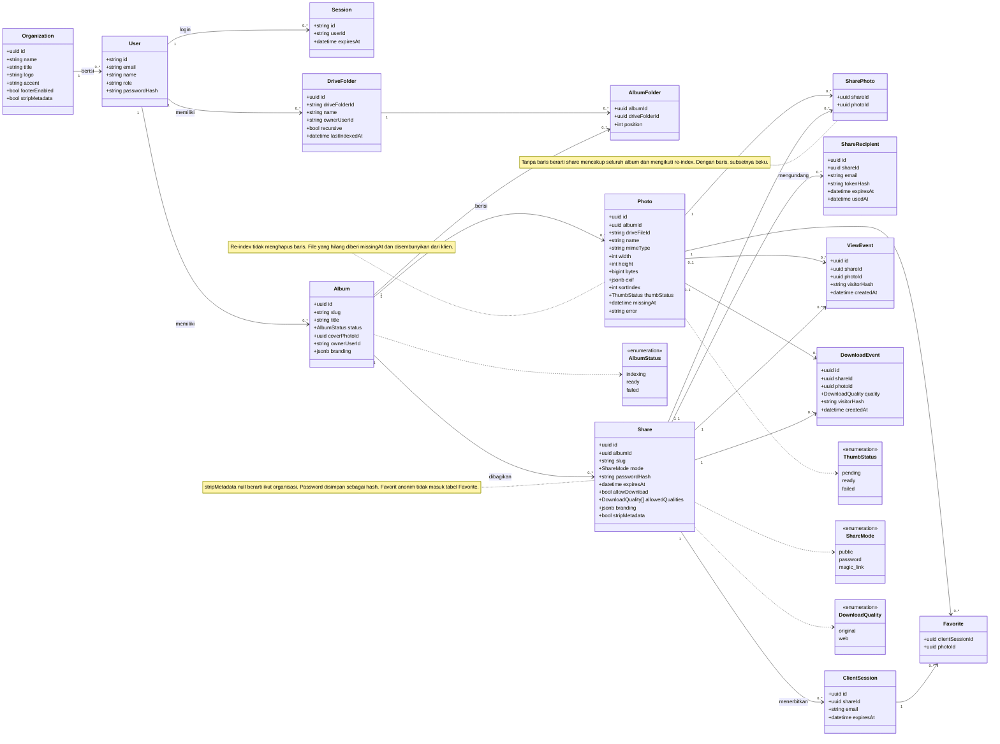
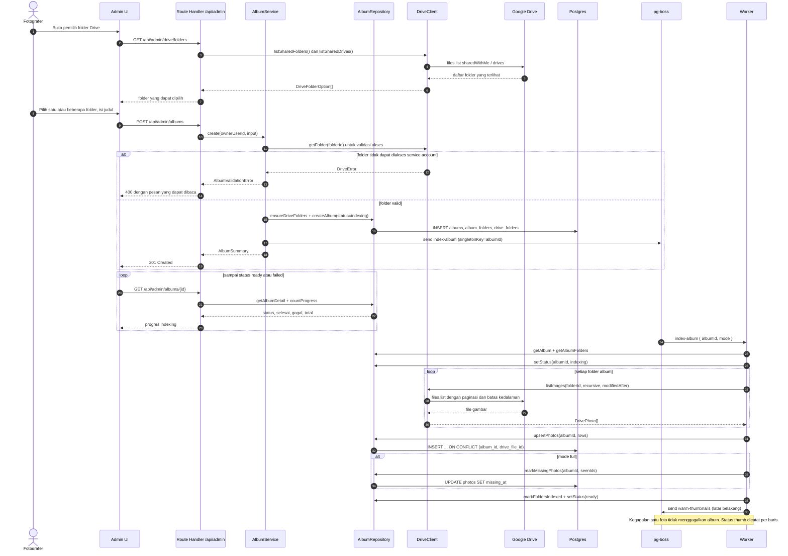
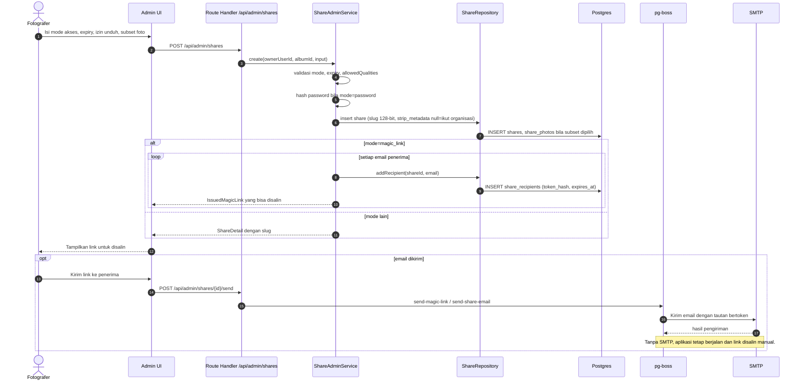
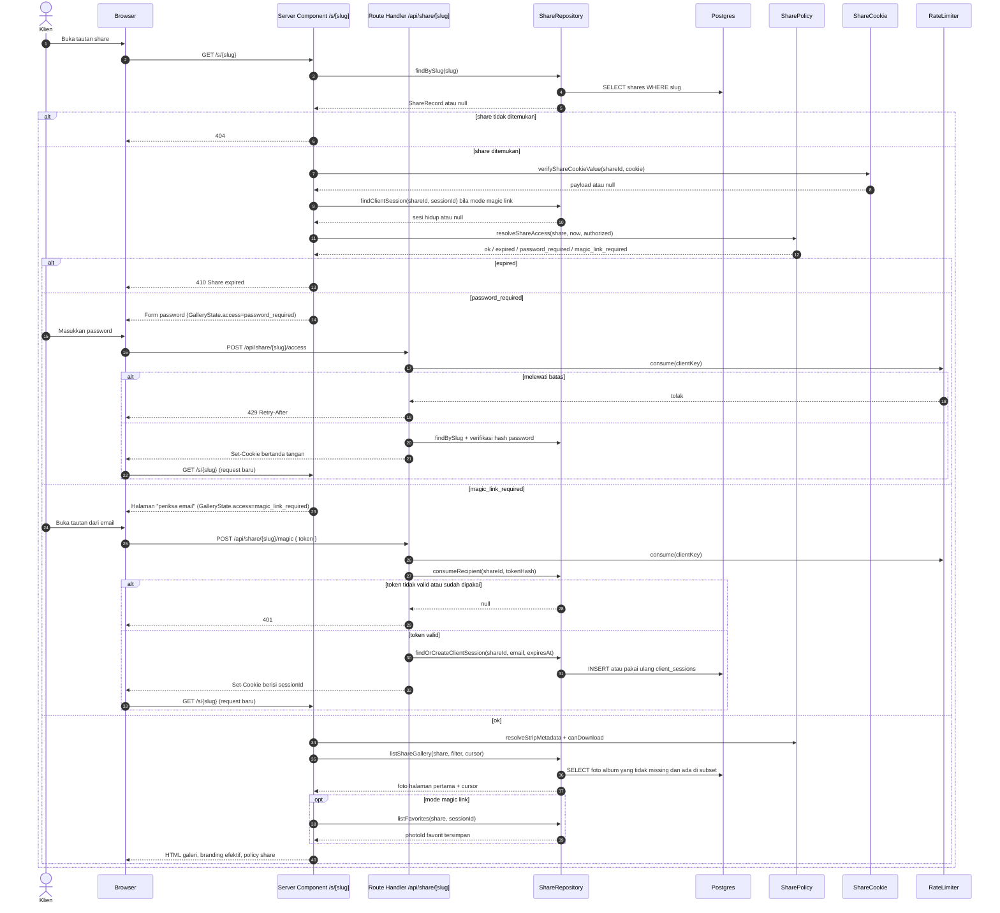
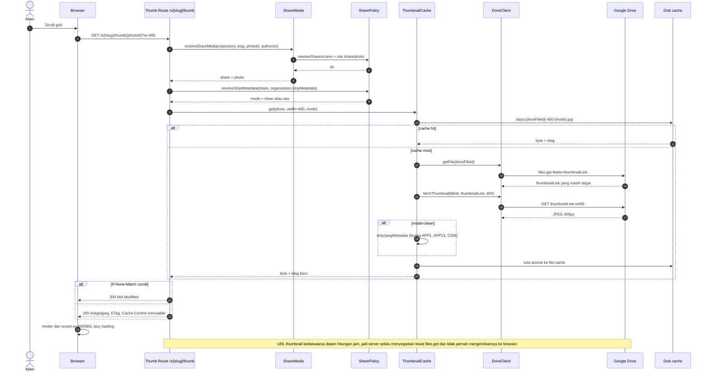
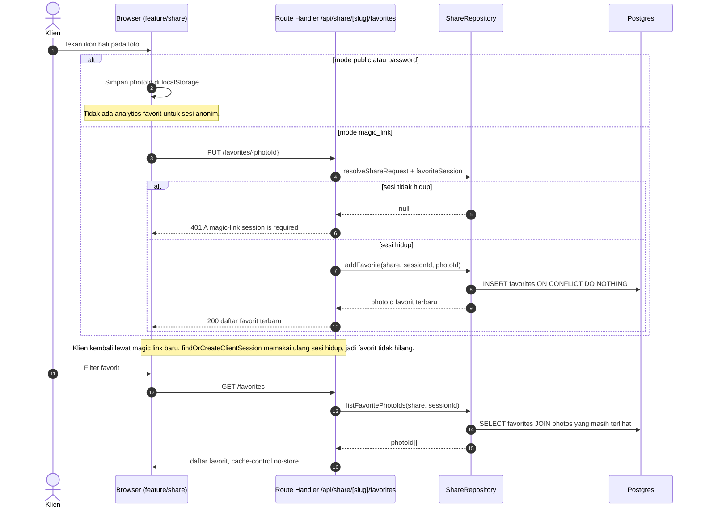
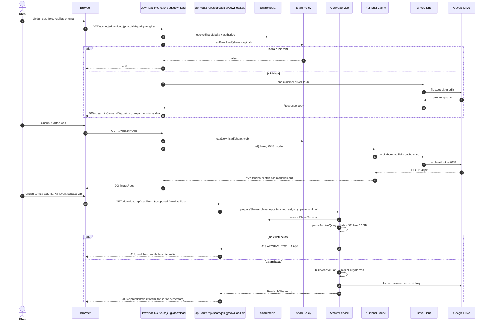
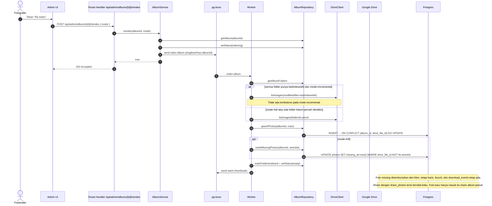

# Potokuadrat — Use Case, Class, dan Sequence Diagram

Tanggal: 2026-11-18
Sumber: `docs/specs/2026-10-30-potokuadrat-client-gallery-design.md`
Struktur kode: `docs/ARCHITECTURE.md`, `docs/WORKFLOW.md`

Dokumen ini menurunkan spesifikasi menjadi tiga kelompok diagram: **use case** (siapa
melakukan apa), **class** (entitas domain dan modul server), dan **sequence** (urutan
pesan untuk alur yang mudah salah). Semua diagram memakai Mermaid sehingga ikut
ter-review bersama kode. Diagram menggambarkan **desain v1**; selisih dengan kode yang
sudah ada dicatat di §5.

## Daftar diagram

| ID | Jenis | Isi |
| --- | --- | --- |
| UC | Use case | Aktor, batas sistem, dan seluruh use case v1 |
| CD-01 | Class | Model domain persisten (tabel Postgres §18) |
| CD-02 | Class | Modul server, port, dan ketergantungannya |
| SQ-01 | Sequence | Daftarkan folder, buat album, indexing, progres |
| SQ-02 | Sequence | Buat share dan terbitkan magic link |
| SQ-03 | Sequence | Klien membuka share dan resolusi akses |
| SQ-04 | Sequence | Grid + thumbnail: cache miss, strip metadata, ETag |
| SQ-05 | Sequence | Favorit: sesi magic link vs localStorage |
| SQ-06 | Sequence | Unduhan: file asli, web 2048px, dan zip stream |
| SQ-07 | Sequence | Re-index: upsert, tombstone `missing`, subset beku |

---

## 1. Use case diagram

Aktor manusia: **Admin organisasi**, **Fotografer (member)**, **Klien** (tanpa akun).
Aktor sistem: **Service account Drive** (akses baca), **Worker pg-boss**, dan **SMTP**.

Catatan use case:

- **UC-21 Favorit** punya dua wujud: baris `favorites` untuk sesi magic link, dan
  `localStorage` untuk share public/password. Hanya sesi beridentitas yang dihitung di
  analytics (§22).
- **UC-22** mencakup dua kualitas, `original` dan `web`; keduanya tunduk pada
  `allow_download` dan `allowed_qualities`.
- **UC-01** hanya dapat dijangkau selama belum ada user; setelah itu `/setup`
  mengarah ke `/login` (§24).
- **UC-24/25/26/27** tidak dipanggil pengguna secara langsung; dipicu oleh Server
  Action atau route handler melalui `pg-boss`.

---

## 2. Class diagram

### CD-01 — Model domain persisten

Bentuk kelas mengikuti tabel di §18 dan schema Drizzle di `src/server/db/schema/`.

Aturan yang tidak terlihat di diagram:

- Indeks unik: `(album_id, drive_file_id)` pada `photos`, `shares.slug`, `albums.slug`,
  `drive_folders.drive_folder_id`, `(share_id, email)` pada `share_recipients`.
- `albums.cover_photo_id` sengaja bukan foreign key; validasinya di application layer.
- Cache thumbnail **tidak** punya tabel: ia hidup di disk sebagai
  `<drive_file_id>-<width>-<mode>.jpg` dan boleh dihapus kapan saja (§18).
- Deduplikasi antar album tidak dilakukan di v1.

### CD-02 — Modul server dan port

Kelas di bawah adalah unit yang benar-benar dipakai route handler, Server Action, dan
worker. `..>` berarti "bergantung pada", bukan pewarisan.

```mermaid
classDiagram
  direction TB

  class RouteHandlers {
    <<adapter>>
    +shareRoute(slug)
    +thumbRoute(slug,photoId,w)
    +downloadRoute(slug,photoId,quality)
    +zipRoute(slug,quality,scope)
    +favoritesRoute(slug)
    +magicRoute(slug)
    +adminAlbumsRoute()
    +adminSharesRoute()
  }

  class ServerActions {
    <<adapter>>
    +createAlbumAction()
    +updateAlbumAction()
    +createShareAction()
    +sendShareEmailAction()
    +updateOrganizationAction()
  }

  class AlbumService {
    <<service>>
    +list(ownerUserId)
    +create(ownerUserId,input)
    +detail(albumId)
    +reindex(albumId,mode)
    +update(ownerUserId,albumId,input)
    +remove(ownerUserId,albumId)
    +setCover(ownerUserId,albumId,photoId)
  }

  class ShareAdminService {
    <<service>>
    +list(ownerUserId,albumId)
    +create(ownerUserId,albumId,input)
    +update(ownerUserId,shareId,input)
    +remove(ownerUserId,shareId)
    +setPhotos(ownerUserId,shareId,photoIds)
    +addRecipient(ownerUserId,shareId,email)
    +reissueMagicLink(ownerUserId,shareId,recipientId)
  }

  class ShareGallery {
    <<module>>
    +parsePhotoQuery(searchParams)
    +listShareGallery(repository,request,slug,searchParams)
    +listFavorites(repository,request,slug)
    +encodePhotoCursor(cursor)
  }

  class ShareRequestContext {
    <<module>>
    +authorizeShareRequest(repository,request,share)
    +resolveShareRequest(repository,request,slug)
  }

  class FavoritesService {
    <<module>>
    +favoriteSession(share,sessionId)
    +addFavorite(repository,request,slug,photoId)
    +removeFavorite(repository,request,slug,photoId)
  }

  class ShareMedia {
    <<module>>
    +resolveShareMedia(repository,slug,photoId,options)
  }

  class SharePolicy {
    <<module>>
    +isShareActive(share,now)
    +canDownload(share,quality)
    +resolveStripMetadata(share,orgDefault)
    +resolveShareAccess(share,now,authorized)
  }

  class ArchiveService {
    <<module>>
    +buildArchivePlan(photos,quality)
    +prepareShareArchive(repository,request,slug,params,drive)
  }

  class AuthSession {
    <<module>>
    +getSession()
    +requireUser()
    +requireAdmin()
  }

  class RateLimiter {
    +consume(key)
  }

  class ShareCookie {
    <<module>>
    +createShareCookieValue(shareId,payload)
    +verifyShareCookieValue(shareId,raw)
  }

  class DriveClient {
    <<interface>>
    +getFolder(folderId)
    +listSharedFolders()
    +listSharedDrives()
    +listImages(folderId,options)
    +getFile(fileId)
    +fetchThumbnail(fileId,thumbnailLink,width)
    +openOriginal(fileId)
  }

  class ThumbnailCache {
    <<interface>>
    +get(photo,width,mode)
    +enforceLimits()
  }

  class JpegStripper {
    <<module>>
    +stripJpegMetadata(buffer)
  }

  class AlbumRepository {
    <<interface>>
    +listAlbums(ownerUserId)
    +ensureDriveFolders(ownerUserId,folders)
    +createAlbum(input)
    +getAlbum(albumId)
    +getAlbumFolders(albumId)
    +upsertPhotos(albumId,rows)
    +markMissingPhotos(albumId,seenIds)
    +markFoldersIndexed(folderIds,at)
    +setStatus(albumId,status)
    +countProgress(albumId)
  }

  class ShareRepository {
    <<interface>>
    +findBySlug(slug)
    +getSharePhoto(share,photoId)
    +listSharePhotos(share,options)
    +listShareArchivePhotos(share,options)
    +consumeRecipient(shareId,tokenHash)
    +findOrCreateClientSession(shareId,email,expiresAt)
    +findClientSession(shareId,sessionId)
    +addFavorite(share,sessionId,photoId)
    +removeFavorite(sessionId,photoId)
    +listFavoritePhotoIds(share,sessionId)
  }

  class JobQueue {
    <<module>>
    +enqueueIndexAlbum(albumId,mode)
  }

  class Worker {
    <<process>>
    +startWorkers()
    +handleIndexAlbum(job)
  }

  RouteHandlers ..> ShareGallery
  RouteHandlers ..> ShareMedia
  RouteHandlers ..> ShareRequestContext
  RouteHandlers ..> FavoritesService
  RouteHandlers ..> ArchiveService
  RouteHandlers ..> AuthSession
  RouteHandlers ..> ShareCookie
  RouteHandlers ..> RateLimiter
  RouteHandlers ..> ShareRepository
  RouteHandlers ..> AlbumService

  ServerActions ..> AlbumService
  ServerActions ..> ShareAdminService
  ServerActions ..> JobQueue
  ServerActions ..> AuthSession

  AlbumService ..> AlbumRepository
  AlbumService ..> DriveClient
  AlbumService ..> JobQueue

  ShareAdminService ..> ShareRepository
  ShareAdminService ..> SharePolicy

  ShareGallery ..> ShareRepository
  ShareGallery ..> SharePolicy
  ShareGallery ..> ShareRequestContext
  ShareMedia ..> ShareRepository
  ShareMedia ..> SharePolicy
  ShareMedia ..> ShareCookie
  ShareRequestContext ..> ShareRepository
  ShareRequestContext ..> SharePolicy
  ShareRequestContext ..> ShareCookie
  FavoritesService ..> ShareRequestContext
  FavoritesService ..> ShareRepository

  ArchiveService ..> ShareRepository
  ArchiveService ..> DriveClient
  ArchiveService ..> ThumbnailCache
  ArchiveService ..> SharePolicy

  Worker ..> JobQueue
  Worker ..> AlbumRepository
  Worker ..> DriveClient

  ThumbnailCache ..> DriveClient
  ThumbnailCache ..> JpegStripper
  DriveClient ..> ThumbnailCache : fetchThumbnail memakai cache
```

Catatan modul:

- Route handler tidak memuat aturan bisnis; ia memvalidasi input HTTP, memanggil satu
  use case, lalu memetakan hasil ke response (`docs/WORKFLOW.md`).
- **Binary selalu route handler**: thumbnail, unduhan asli, dan zip butuh streaming
  serta header (`Content-Disposition`, `ETag`, `Cache-Control`).
- Tidak ada `StorageService`. Cache thumbnail bersifat disk-local dan tidak butuh
  abstraksi driver (§17).
- `DriveClient` adalah satu-satunya tempat yang menyentuh `drive.readonly`; kunci
  service account tidak pernah keluar dari proses server.

---

## 3. Sequence diagram

### SQ-01 — Daftarkan folder, buat album, indexing

Mencakup UC-05, UC-06, UC-07, UC-24, dan UC-25. Indexing tidak mengunduh file asli;
worker hanya membaca metadata dan menyimpan baris `photos`.

### SQ-02 — Buat share dan terbitkan magic link

Mencakup UC-10 sampai UC-14. Share adalah unit kontrol akses; album tidak pernah
diakses langsung oleh klien.

### SQ-03 — Klien membuka share dan resolusi akses

Mencakup UC-17, UC-18, dan UC-19 (first paint). Halaman galeri adalah Server
Component; penukaran password/magic link adalah route handler.

### SQ-04 — Grid dan thumbnail: cache miss, strip, ETag

Mencakup UC-19, UC-25, dan UC-28. Browser tidak pernah menerima URL Drive; hanya
`/s/{slug}/thumb/{photoId}?w=...` milik Potokuadrat.

### SQ-05 — Favorit: sesi magic link vs localStorage

Mencakup UC-21. Hanya sesi beridentitas yang menulis ke Postgres; share public dan
password menyimpan favorit di browser.

### SQ-06 — Unduhan: file asli, web 2048px, dan zip

Mencakup UC-22 dan UC-23. Tidak ada file asli yang disimpan; zip dialirkan saat
request dan tidak pernah ditulis ke disk.

### SQ-07 — Re-index: upsert, tombstone, subset beku

Mencakup UC-09 dan UC-24. Re-index penuh menandai file yang hilang sebagai `missing`,
bukan menghapus baris; favorit dan riwayat unduhan tetap valid.

---

## 4. Aturan lintas diagram

| Aturan | Diagram yang menegakkannya |
| --- | --- |
| Share adalah unit akses, bukan album | UC-10, SQ-03, SQ-04 |
| Kunci service account tidak pernah ke browser | CD-02, SQ-01, SQ-04 |
| Tidak ada URL Drive di response | SQ-04, SQ-06 |
| File asli tidak disimpan | SQ-06 |
| `missing` bukan delete | CD-01, SQ-07 |
| `strip_metadata` default aktif; override per share | CD-01, SQ-04, SQ-06 |
| Cache boleh dihapus dan dibangun ulang | CD-01, SQ-04, SQ-06 |
| Zip dialirkan, bukan diarsipkan ke disk | SQ-06 |
| Favorit anonim tidak masuk analytics | UC-21, SQ-05 |

---

## 5. Status implementasi

Diagram di atas adalah desain v1. Beberapa bagian sudah ada di repo, sebagian masih
mengikuti rencana §11:

| Bagian | Status |
| --- | --- |
| Schema domain, `AlbumService`, `ShareAdminService` | Ada di `src/server/**` |
| Akses share, cookie, rate limit, favorit | Ada di `src/server/shares/**` |
| Drive client, cache thumbnail, strip metadata | Ada di `src/server/drive/**` |
| Unduhan asli, web, dan zip | Ada di route `download` dan `download.zip` |
| Job `index-album` | Ada di `src/server/jobs/**` |
| Job `warm-thumbnails`, `send-magic-link`, `send-share-email`, `cleanup` | Direncanakan §11, belum ada di `src/server/jobs/**` |
| Endpoint analytics share (UC-16) | Direncanakan §15, belum ada route-nya |

Kalau job atau endpoint baru ditambahkan, perbarui §1, CD-02, dan sequence yang
bersangkutan agar dokumen ini tetap menjadi satu-satunya rujukan diagram.
